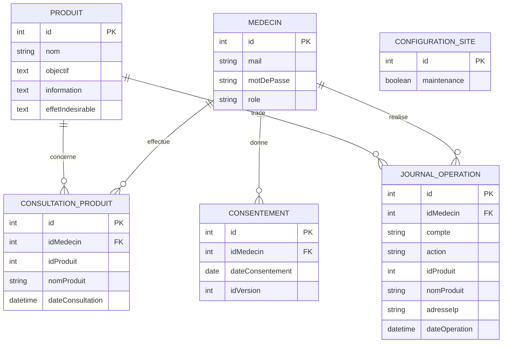

# MCD de l'administration GSB

## Entités

- **Medecin** : compte de la personne connectée. Le champ `role` vaut `medecin`, `chef_produit` ou `admin`.
- **Produit** : informations affichées aux médecins et gérées par les chefs de produit.
- **ConsultationProduit** : trace chaque consultation d'une fiche produit.
- **JournalOperation** : garde la trace des créations, modifications et suppressions de produits.
- **ConfigurationSite** : conserve l'état de maintenance du site.
- **Consentement** : conserve la date et la version du consentement donné lors de l'inscription.

## Associations

- Un médecin peut effectuer plusieurs consultations ; une consultation appartient à un médecin. Si le compte est supprimé, la trace reste et son identifiant devient vide.
- Une consultation conserve le nom du produit consulté. Cette copie permet de garder les statistiques même si le produit est ensuite désactivé.
- Un médecin (chef de produit ou administrateur) peut effectuer plusieurs opérations. Le journal conserve aussi son adresse e-mail au moment de l'action et son adresse IP.
- Une opération concerne un produit. Son identifiant peut rester dans le journal après la suppression du produit.
- Le site possède une seule configuration de maintenance (identifiant `1`).
- Un médecin peut avoir plusieurs consentements enregistrés.

Le schéma SQL de référence se trouve dans [`scriptBDD/gsbextranetStructures.sql`](../scriptBDD/gsbextranetStructures.sql).
